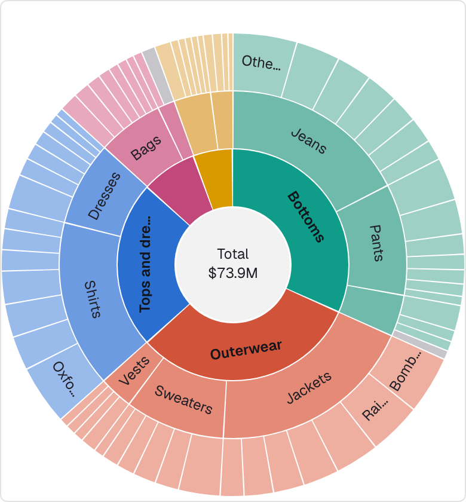
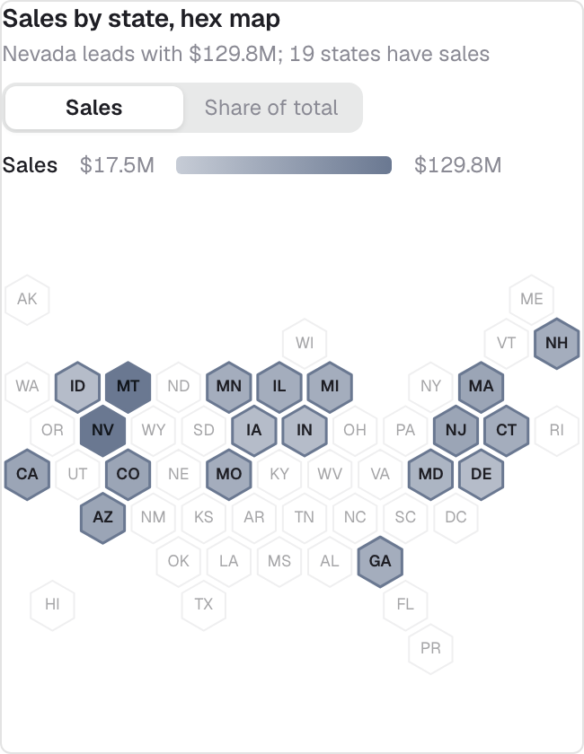
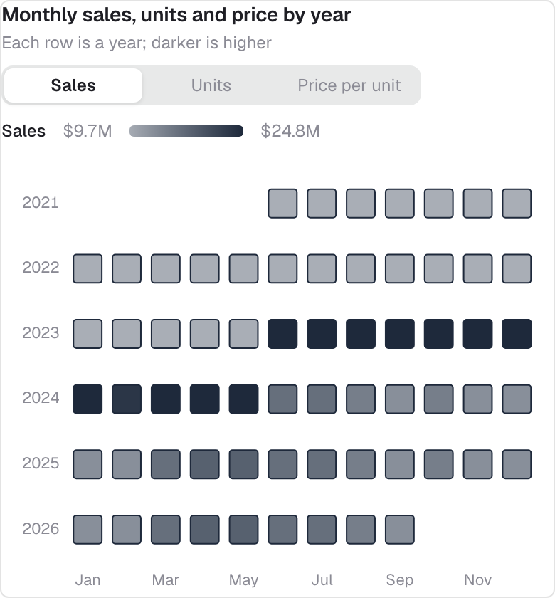

<div align="center">

# ThoughtSpot Amuzing chart skills

**Describe a chart. Get a ThoughtSpot custom chart that has already been rendered and checked.**

Two Claude skills that build ThoughtSpot custom charts (BYOC), and whole Liveboards of them,<br>by running the code in a real browser until it looks right.

**[Install](#install)** · **[How it works](#how-it-works)** · **[Chart libraries](#chart-libraries)** · **[The chart library](#the-chart-library)** · **[Check your setup](#check-your-setup)**

</div>

<br>

<table>
  <tr>
    <td></td>
    <td></td>
    <td></td>
  </tr>
</table>

## What you get

- **A chart that was seen, not guessed.** Claude writes `chart.html`, `chart.css` and `chart.js`, screenshots the render, reads the screenshot, fixes the worst defect and repeats, up to 8 times.
- **No porting step.** The preview runs the same three files you paste, through a stub of ThoughtSpot's `viz` host, so what was checked is what ships.
- **Edge cases checked.** Missing, object-wrapped and empty data, no host at all, and narrow and wide tiles.
- **Real data when connected.** With the ThoughtSpot MCP, each chart is built on the exact output of its own search, and can be saved as an answer.
- **Whole Liveboards.** The second skill plans numbered tabs on a real model, has each tile built, adds filters, imports, proves the import and screenshots every tab.
- **Your choice of library.** You pick one, or let Claude pick by shape: MayaCharts, D3, ECharts, Plotly, Chart.js, gridjs, HTML tables or raw SVG.

## Two skills

| Skill | Use it to |
|---|---|
| **ts-object-answer-chart-builder** | Build, rebuild, debug or convert one chart. Start from a description, a screenshot of a chart, or a tile that misbehaves. Ships 58 proven charts. |
| **ts-object-liveboard-chart-builder** | Build a storytelling Liveboard of those charts on a real model through the ThoughtSpot MCP. Needs the chart skill installed beside it. |

## Install

**Claude Code.** Copy both skills into your project, or symlink them once for every project:

```bash
git clone git@github.com:BibekTS/Thoughtspot-Amuzing-chart-skills.git
mkdir -p your-project/.claude/skills
cp -R Thoughtspot-Amuzing-chart-skills/skills/* your-project/.claude/skills/
# or: for s in ts-object-answer-chart-builder ts-object-liveboard-chart-builder; do ln -s "$PWD/Thoughtspot-Amuzing-chart-skills/skills/$s" ~/.claude/skills/$s; done
```

Needs Node 20+. The first run installs Playwright and Chromium (about 2 min, asked once).

**Claude app.** Turn on *Settings → Capabilities → Code execution and file creation*, build the bundle, and upload it under *Settings → Capabilities → Skills*:

```bash
cd skills && zip -r ../ts-object-answer-chart-builder.zip ts-object-answer-chart-builder -x '*/node_modules/*' '*.DS_Store' '*/library/*/preview.png'
```

Same for `ts-object-liveboard-chart-builder`. In the app the Liveboard skill cannot take the in-cluster screenshots, because they need a browser window you sign in to.

**Use it.** Ask for a chart (*"a diverging bar of revenue vs target by region"*), attach a screenshot, point it at a tile that misbehaves, or run `/ts-object-answer-chart-builder`. Paste `chart.html`, `chart.css` and `chart.js` into the HTML, CSS and JS tabs of your custom chart.

Runs and deliverables land in `~/.cache/ts-charts/` (or `$XDG_CACHE_HOME`), never inside a repo. `TS_CHART_HOME` and `TS_CHART_OUTPUT_ROOT` override that.

## How it works

1. **Intake.** Pick-from-a-list questions: model, data mode, search, chart library, destination.
2. **Frozen sample.** The data mode is settled and the rows are frozen for the run (your CSV if you bring one).
3. **Loop.** Edit, screenshot, critique with vision, fix. It stops early on a match, and asks you if it is getting nowhere.
4. **Checks.** Data edge cases, tile resizes and pointer interaction.
5. **Deliverables.** The three files, a `preview.png` and a `README.md` naming the exact search to build.

| | Claude Code | Claude app |
|---|---|---|
| Preview | A Chromium window you watch | Headless; each attempt comes back as a PNG |
| First run | Installs Playwright + Chromium | Installs `playwright-core`, uses the sandbox's Chromium |
| Libraries | All | HTML tables and raw SVG are fully previewed; CDN libraries are usually blocked, so those charts are written and marked *not previewed* |

## Chart libraries

The skill builds in any of these. Ask for one by name, or let Claude pick by the chart's shape:

| Library | Claude reaches for it for | Loaded as |
|---|---|---|
| [MayaCharts](https://bbekshr.github.io/mayacharts/) | Standard business shapes: bar, line, area, scatter, KPI, waterfall, heatmap, table, treemap, sunburst, sankey, chord, funnel, box plot, gauge. Includes ghost-of-last-period bars, target colouring, reference lines, playback and animated drill-down | CDN, pinned (0.18.1 today) |
| [D3](https://d3js.org/) | Bespoke layouts: stream graphs, force layouts (beeswarm), parallel coordinates | CDN, pinned (7.9.0 in the starter) |
| [ECharts](https://echarts.apache.org/) | Dense flow diagrams that MayaCharts' sankey cannot lay out | CDN, pinned (5.6.0 in the starter) |
| [Plotly](https://plotly.com/javascript/) | Icicles, and hierarchies MayaCharts cannot draw | CDN, pinned (2.35.2 in the example) |
| [Chart.js](https://www.chartjs.org/) | Radar, polar, doughnut, gauges, background bands, conditional bar colours | CDN, pinned (4.6.1 in the starter) |
| [Grid.js](https://gridjs.io/) | Sortable tables | CDN, pinned at build time |
| HTML table | Pivots, crosstabs, print-style output | Inline, no download |
| Raw SVG / Canvas | KPI tiles that are mostly typography, hand-drawn maps | Inline, no download |
| Raw HTML/CSS | Quote cards, text slides, annotation blocks | Inline, no download |

Every CDN script is pinned to an exact version and carries a sha384 `integrity` value, so a saved tile never changes under you. A file that changes on the CDN is refused. Tiles can load scripts from a CDN, but `fetch()` is blocked inside them, so data files and maps are inlined. Where the doctor reports `cdn: blocked` (usual in the Claude app), CDN charts are still written but marked *not previewed*.

The shipped [chart library](#the-chart-library) uses two of these: 48 MayaCharts specs, and 10 hand-built SVG and HTML tiles.

When Claude picks, MayaCharts (MIT, no dependencies) is the first fit for standard business shapes. One JSON spec gives the marks, tooltip, keyboard focus, selection, drill, empty state and resize. A standalone tile is the spec and one adapter call:

```js
maya.host.thoughtspot(viz, { type: 'bar', x: 'Item Type', y: 'Total Sales', title: '{max.x} leads with {max.y}' });
```

Fields are plain column names. The adapter reads the search, unwraps cells, mounts the chart and tells ThoughtSpot the tile is done. The doctor finds the latest MayaCharts release and every chart pins it (now 0.18.1), so a saved tile never changes under you. The theme lives in `chart.css` as `--maya-*` properties on `#chart`.

## The chart library

`skills/ts-object-answer-chart-builder/library/` holds **58 charts** on *(Sample) Retail - Apparel*; 50 are arranged as the Liveboard **Amuzing chart samples**: seven tabs (About, Pulse, Where, What, When, Who, Next), custom charts only, with date, region and item-type filters. 48 are MayaCharts specs; the rest are text tiles, `next-action-list` and `next-what-if`. They were rebuilt on synthetic data and are marked *preview only* until seen on a cluster tile.

- [references/library.md](skills/ts-object-answer-chart-builder/references/library.md) indexes them by tab, library and search.
- [references/examples.md](skills/ts-object-answer-chart-builder/references/examples.md) maps a chart shape to the one to copy.
- They are one worked Liveboard, not 58 model-agnostic templates: on another model a copy needs its search, copy and a few lines changed.

## Check your setup

```bash
node .claude/skills/ts-object-answer-chart-builder/helpers/env.mjs
```

The doctor prints where runs go, headed or headless, whether Chromium launches, whether CDN libraries are reachable and the latest MayaCharts release. Each problem has a `fix:` line. The helpers also work by hand:

```bash
H=.claude/skills/ts-object-answer-chart-builder/helpers
node $H/start-preview.mjs my-chart            # open the preview window
node $H/snap.mjs my-chart 01                  # screenshot + diagnostics
node $H/snap.mjs my-chart 91 --data=empty     # also: absent, wrapped, noviz; --tile=620x400
node $H/probe.mjs my-chart --sweep            # does hovering change anything
```

## Layout

```
skills/ts-object-answer-chart-builder/    SKILL.md · references/ · library/ (58 charts + shared core) · examples/ · helpers/ · scaffold/
skills/ts-object-liveboard-chart-builder/ SKILL.md · references/ · scripts/ · narratives/ · liveboards/amuzing-chart-samples/
scripts/export-to-library.sh              copy both skills into thoughtspot-agent-skills
```

Each skill's `SKILL.md` is the procedure Claude follows. The Liveboard skill finds the chart skill as a sibling folder (or through `TS_ANSWER_CHART_SKILL`).

## Status

"Verified in preview" means checked against a stub of the ThoughtSpot host, not your cluster: theme and version differences are real, so look at the pasted tile. Facts about tiles that only a cluster shows (for example, `fetch()` is blocked inside a tile) are in [references/hard-rules.md](skills/ts-object-answer-chart-builder/references/hard-rules.md).

- **2026-10-26, macOS, headless:** all 58 library charts render with live and empty data and no console errors, with SRI on every CDN script; a tampered hash is blocked. Not yet checked on a cluster tile.
- **2026-10-14, macOS, MayaCharts 0.18.1:** all 48 MayaCharts library charts and the standalone example render in live, empty, absent and wrapped data with no console errors. Not yet checked on a cluster tile.
- **2026-09-29, macOS:** headed and headless previews, the fall back to headless, and the hand-built SVG KPI.
- **Not yet run inside the Claude app itself.** The doctor output from a first run there is the thing to check.

For maintainers: these skills are being prepared for [thoughtspot/thoughtspot-agent-skills](https://github.com/thoughtspot/thoughtspot-agent-skills). This repo stays the source; copy with `scripts/export-to-library.sh /path/to/thoughtspot-agent-skills`.

## License

[MIT](LICENSE)
